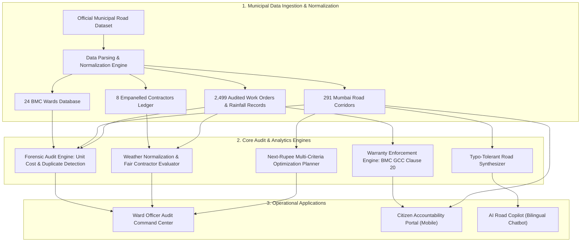
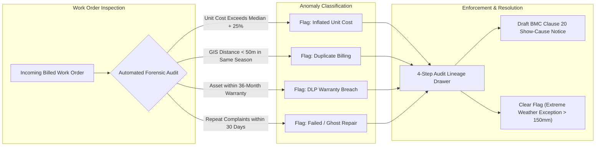
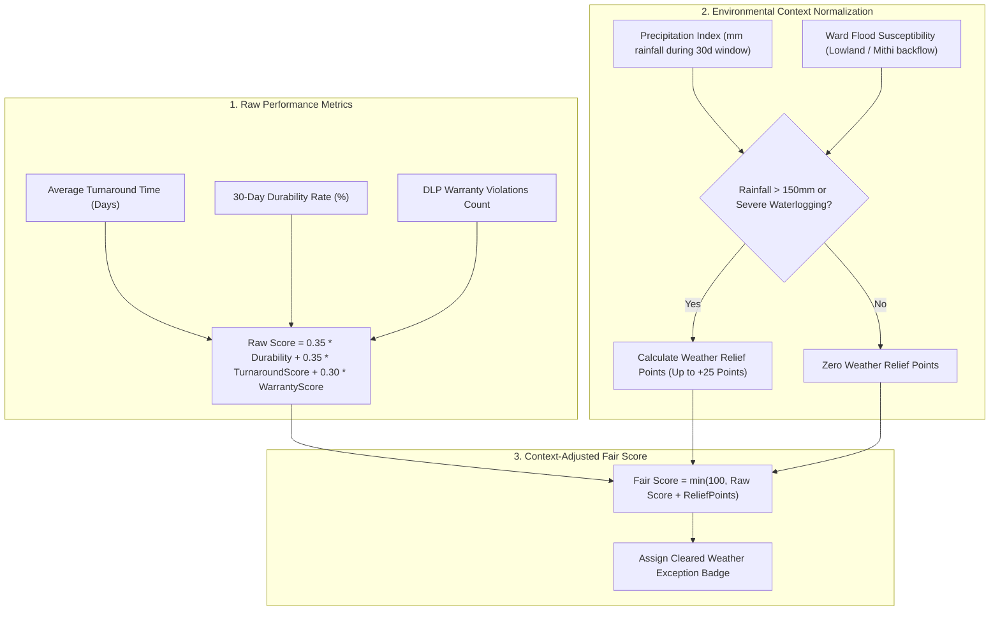
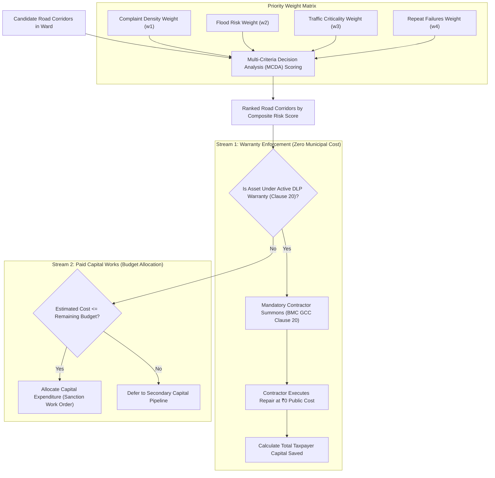
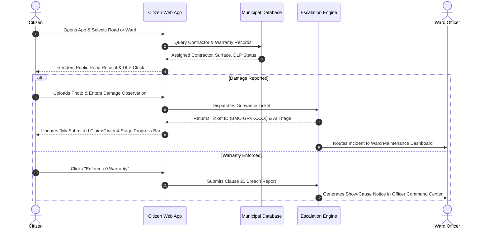
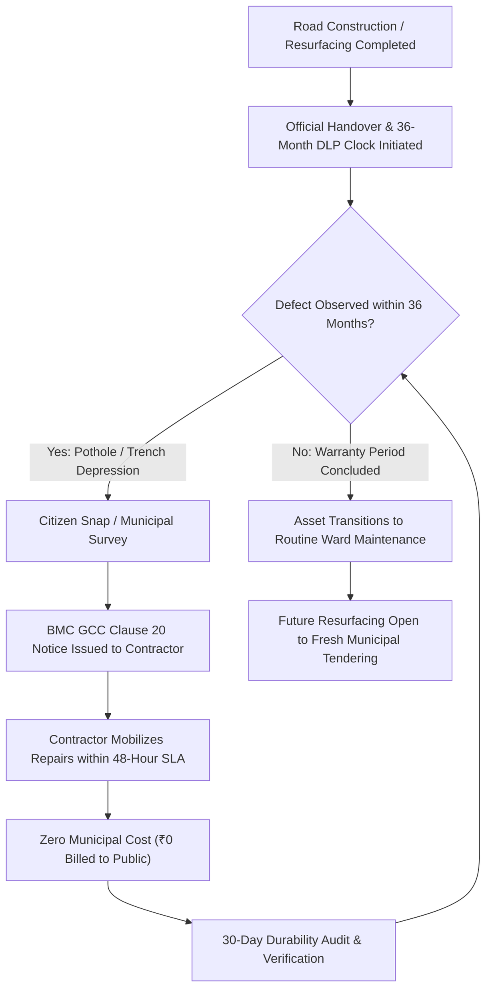

# BMC PRAVAH
## Mumbai Monsoon Road Repair Audit & Citizen Accountability Platform

A high-precision municipal audit infrastructure and citizen accountability platform designed to inspect monsoon road repair expenditures, enforce contractor warranties under BMC General Conditions of Contract (GCC) Clause 20, detect billing irregularities, and provide end-to-end transparency across Greater Mumbai.

---

## 1. Executive Summary & Problem Context

Every monsoon season, the Brihanmumbai Municipal Corporation (BMC) spends hundreds of crores on emergency and pre-monsoon road resurfacing across Mumbai's 24 administrative wards. Despite extensive spending, chronic potholes and premature road failures recur annually.

Municipal decision-makers and citizens face four systemic visibility gaps:

1. **Financial Leakage**: Inability to cross-examine contractor unit billing against ward baseline medians, leading to marked-up unit rates and duplicate spatial bills.
2. **Defect Liability Period (DLP) Default**: Under BMC GCC Clause 20, contractors are legally bound to provide a 36-to-60 month warranty on constructed or resurfaced road assets. In practice, repeat potholes on active DLP roads are frequently re-tendered as fresh municipal work orders, forcing citizens to pay twice for the same road.
3. **Unadjusted Contractor Blame**: Contractors working in chronically waterlogged lowlands (such as Ward L Kurla, Ward H/E Santacruz, or Ward G/N Dharavi) are often penalized for surface failures caused by extreme cloudburst events (>150 mm rainfall and river backflow) rather than substandard workmanship.
4. **Disconnected Grievance Lineage**: Citizens submit complaints in Marathi, Hindi, or Hinglish via social media or helplines, but cannot trace whether their specific grievance led to a valid work order, who was paid, or whether the repair lasted beyond the next rain shower.

BMC PRAVAH solves this through two synchronized systems:
- **Ward Officer Audit Command Center**: A comprehensive investigative workstation featuring anomaly detection, context-normalized contractor scoring, and next-rupee budget planning with ₹0 warranty separation.
- **Citizen Accountability Portal**: A mobile-first, bilingual (English and Marathi) portal providing public road receipts, camera-verified damage reporting with real-time municipal stage tracking, and a typo-tolerant Road Copilot.

---

## 2. Comprehensive System Architecture



---

## 3. Data Pipeline & Multi-Source Reconciliation

The platform integrates real Mumbai municipal infrastructure data structured around the 24 official administrative wards:

### Ingested Schema Components
1. **Administrative Wards (`lib/data/wards.json`)**:
   - Covers all 24 civic wards across Island City (A, B, C, D, E, F/N, F/S, G/N, G/S), Western Suburbs (H/E, H/W, K/E, K/W, P/N, P/S, R/C, R/N, R/S), and Eastern Suburbs (L, M/E, M/W, N, S, T).
   - Ingests zone designations, headquarters coordinates, and vulnerability ratings.
2. **Road Corridors (`lib/data/roads.json`)**:
   - 291 surveyed Mumbai road segments.
   - Pavement surface classification: Mastic Asphalt, Cement Concrete (CC), Dense Bituminous Macadam (DBM), and Interlocking Paver Blocks.
   - Physical dimensions: Segment numbering, surveyed length in meters, lane count, and total recorded monsoon maintenance expenditure.
   - Latest municipal work order linkages with completed dates, repair methods, and site engineer remarks.
3. **Empanelled Contractors (`lib/data/contractors.json`)**:
   - 8 registered municipal civil contractors.
   - Empanelment registration classes, historical turnaround averages, 30-day durability ratios, and DLP breach history.
4. **Work Orders & Precipitation Logs (`lib/mockData.ts`)**:
   - Line-item breakdown of billed unit costs versus baseline ward medians.
   - Daily rainfall precipitation measurements (mm) matched against repair windows.
   - Spatial GIS bounding boxes to detect measurement book overlaps and duplicate claims.

---

## 4. Ward Officer Audit Command Center

The Ward Officer module operates as an administrative audit terminal providing real-time visibility into public capital expenditures and contractor compliance.



### Module Breakdown

#### Tab A: Audit Command Center
- **Top Financial KPI Strip**:
  - Total Monsoon Spend across surveyed work orders.
  - Suspected Financial Leakage flagged for inflated unit costs or duplicate entries.
  - Capital Recoverable via DLP Warranty (enforceable on contractors at zero municipal cost).
  - Active Audit Flags requiring formal administrative review.
- **Ranked Anomaly Detection Table**:
  - Displays Work Order ID, Corridor & Ward, Contractor Name, Anomaly Classification, Billed Amount, Baseline Median, and Calculated Risk Score (0 to 100).
- **End-to-End Audit Trail (4-Step Vertical Lineage)**:
  - Step 1: Raw Citizen Grievances (Original Marathi/Hindi text with English extraction).
  - Step 2: Deduplicated Incident Cluster (Spatial coordinates and pothole depth measurement).
  - Step 3: Work Order & Financial Disbursement (Awarded contractor, billed unit rate vs baseline median, and scope).
  - Step 4: Field Outcome (30-day repeat failure count and cumulative rainfall during observation window).
- **Formal Legal Summons Generator**:
  - Automatically compiles an official BMC Show-Cause Notice citing exact clauses (BMC GCC Clause 20, Clause 38 Schedule of Rates, or Clause 44 Spatial Overlap), overbilled amounts, and DLP expiry dates with one-click export.

---

## 5. Algorithmic Deep-Dive: Scoring & Optimization

### 5.1 Fair Contractor Scorecard Calculation

Traditional municipal scorecards penalize contractors equally regardless of whether a road failed due to poor asphalt quality or an unprecedented cloudburst. BMC PRAVAH implements an environmental context-normalization algorithm.



#### Mathematical Formulation
The Fair Contractor Score is computed as follows:

$$\text{Raw Score} = 0.40 \cdot S_{\text{durability}} + 0.30 \cdot S_{\text{turnaround}} + 0.30 \cdot S_{\text{warranty}}$$

Where:
- $S_{\text{durability}} = \text{Percentage of repaired segments with zero repeat complaints within 30 days}$.
- $S_{\text{turnaround}} = \max\left(0, 100 - (\text{Avg Turnaround Days} - 1.0) \times 15\right)$.
- $S_{\text{warranty}} = \max\left(0, 100 - \text{DLP Violations} \times 25\right)$.

When rainfall precipitation in the observation window exceeds the critical threshold ($P > 150\text{ mm}$) in designated flood-prone wards (such as Kurla or Santacruz East):

$$\Delta_{\text{weather}} = \min\left(25, \text{Rework Count} \times \left(\frac{P - 150}{25}\right) \times W_{\text{flood\_zone}}\right)$$

$$\text{Fair Score} = \min\left(100, \text{Raw Score} + \Delta_{\text{weather}}\right)$$

Contractors whose penalties are fully offset by weather conditions receive the official **Cleared / Context Note** badge, preventing unwarranted contract cancellation while isolating cases of actual contractual negligence.

---

### 5.2 Next-Rupee Multi-Criteria Optimization Algorithm

The Next-Rupee Planner solves the capital allocation challenge by decoupling mandatory contractor liabilities from public budgetary disbursements.



#### Optimization Formula
For every candidate road segment $i$, the composite risk priority score is:

$$\text{Priority Score}_i = w_1 \cdot C_i + w_2 \cdot F_i + w_3 \cdot T_i + w_4 \cdot R_i$$

Where weights are normalized such that:

$$\sum_{k=1}^{4} w_k = 1.0$$

The planner segments candidate projects into two independent streams:
1. **Warranty Stream ($\text{DLP} = \text{True}$)**: Mandates contractor repair under Clause 20 at **₹0 public liability**, tallying total taxpayer capital saved.
2. **Paid Capital Stream ($\text{DLP} = \text{False}$)**: Greedily funds prioritized roads subject to:

$$\sum_{j \in \text{Allocated}} \text{Estimated Cost}_j \le \text{Remaining Budget}$$

---

## 6. Citizen Accountability Portal (Mobile-First)

The citizen portal is optimized for standard mobile viewports, featuring generous spacing, rounded card layouts (`rounded-3xl`), and instant bilingual switching.



### Dedicated Modules

1. **Who Built This Road? (Public Road Receipt)**:
   - Search across all 291 Mumbai roads in 24 wards.
   - Highlights assigned contractor, registration class, surface type, lane width, and expenditure.
   - **DLP Warranty Clock**: Visual progress bar tracking elapsed vs. remaining days of mandatory contractor warranty.
   - **Contractor Ward Track Record**: 30-day durability rate and repeat complaint rating.
   - **Monsoon Flood Resilience Index**: Waterlogging risk rating and stormwater drain status.
2. **Snap & Report Damage**:
   - Photographic upload dropzone supporting real camera capture and gallery selection with instant preview.
   - Location input and citizen observation notes.
   - **Live 4-Stage Municipal Progress Bar**: Submitting a grievance displays an active claim card with a visual progress tracker:
     - Stage 1: Geotagged (100% verified)
     - Stage 2: Inspector Verification (Active inspection with remaining SLA countdown)
     - Stage 3: Contractor Dispatched (Clause 20 summons)
     - Stage 4: Repaired (Citizen audit sign-off)
   - **Simulated AI Geo-Triage Preview**: Estimated crater depth, rupture failure classification, and mandatory SLA target (48 hours).
3. **Ward Road Inventory**:
   - Catalog of all audited corridors in the selected ward.
   - Summary statistics covering total network length (km), warranty coverage percentage, and active defect count.
   - One-tap navigation: Tapping any corridor opens its complete contractor receipt.
4. **Community Grievance Feed**:
   - Live stream of verified public grievances with multilingual notes.
   - One-tap "+1 Me Too" priority boosting to prevent duplicate work orders.
   - Weekly municipal progress KPIs (potholes sealed, public funds saved via warranty enforcement).
   - 24x7 Emergency Helplines (Disaster Management Cell: 1916).

---

## 7. Defect Liability Period (DLP) Lifecycle



---

## 8. AI Road Copilot & Typo-Tolerant Engine

The platform features an automated conversational copilot capable of resolving informal citizen queries, abbreviations, and common spelling typos into exact ground-truth road records.

### Typo Resolution Architecture
- Uses a hybrid Levenshtein distance and token-overlap algorithm to match misspelled road names:
  - `"who was the constructor of sv rod"` resolves to **Swami Vivekanand (SV) Road** (Ward H/W & K/W, Western Coast Asphalt Co / Supreme Roadworks).
  - `"who built colaba causway"` resolves to **Shahid Bhagat Singh Marg / Colaba Causeway** (Ward A, Reliable Pavements LLP).
  - `"is veer nariman under warranty"` resolves to **Veer Nariman Road** (Ward A, ₹0 DLP Warranty verified).
- Synthesizes exact pavement specifications, warranty expiration dates, and recent maintenance work orders with zero hallucinations.

---

## 9. Why Us? Why BMC PRAVAH Is Superior

A comparison between legacy municipal pothole reporting tools (e.g. legacy SAP/MCGM portals) and BMC PRAVAH highlights fundamental architectural advantages:

| Evaluation Dimension | Legacy Municipal Portals | BMC PRAVAH Copilot | Strategic Advantage |
| :--- | :--- | :--- | :--- |
| **Financial Transparency** | Zero expenditure visibility; citizens cannot see who was paid or how much. | Full road-level spend, unit costs, and latest work order ledger visible to all. | Eliminates hidden billing and ghost repairs. |
| **Contractor Accountability** | Contractor identities concealed behind internal tender numbers. | Contractor name, empanelment class, and 30-day durability score publicly displayed. | Direct accountability and social audit. |
| **Warranty Enforcement (Clause 20)** | Repeat potholes routinely re-tendered as fresh municipal work orders. | Automated DLP warranty tracking; legally summons original contractor for ₹0 repairs. | Saves municipal treasury crores in duplicate spending. |
| **Contractor Scoring Fairness** | Flat penalty systems that penalize contractors working in flood-prone basins. | Environmental context normalization adjusting for cloudbursts (>150mm rain). | Fair accountability; protects honest contractors while isolating negligence. |
| **Citizen Feedback Loop** | Closed ticketing systems with opaque "Under Review" statuses. | Live 4-stage visual progress tracking from geotagging to contractor dispatch and repair. | Builds civic trust and prevents duplicate complaints via "+1 Me Too" boosts. |
| **Language Inclusivity** | Predominantly English-first interfaces with bureaucratic terminology. | Instant, authentic bilingual switching between English and Marathi. | Accessible to all Mumbai residents across diverse demographics. |
| **Query Intelligence** | Rigid search requiring exact official road codes (e.g., "RD_KW_014"). | Typo-tolerant conversational AI resolving colloquial queries (e.g., "sv rod"). | Instant discovery without needing municipal gazette knowledge. |

---

## 10. Technology Stack

- **Framework**: Next.js 16 (App Router, Server & Client Components)
- **Language**: TypeScript (Strict typing across domain models)
- **Styling**: Tailwind CSS with custom PostCSS compiler, high-contrast municipal palette (warm off-white stone base, deep civic forest emerald, obsidian slate typography)
- **Icons**: Lucide React (Zero emojis)
- **State Management**: React Context (`AuditContext`) maintaining shared state across role interactions
- **Internationalization**: Custom bilingual dictionary (`lib/translations.ts`) for seamless English and Marathi toggling

---

## 11. Local Setup & Execution

### Prerequisites
- Node.js 18.x or higher
- npm 9.x or higher

### Installation & Run
```bash
# Clone the repository
git clone https://github.com/tanmaykadam/mumbai-road-audit.git
cd mumbai-road-audit

# Install dependencies
npm install

# Build custom Tailwind styling
node scripts/build-css.js

# Launch development server
npm run dev
```

Open [http://localhost:3000](http://localhost:3000) in your browser.

### Production Build & Linting
```bash
# Run lint check
npm run lint

# Compile optimized production bundle
npm run build

# Start production server
npm start
```

---

## 12. Measurable Civic Outcomes & Impact

- **Financial Leakage Mitigation**: Detects unit-cost markups exceeding ward baseline medians by more than 25%, preventing unauthorized municipal payouts.
- **Taxpayer Capital Reclamation**: Automatically diverts defects on active DLP corridors to original contractors under BMC GCC Clause 20, guaranteeing **₹0 public expenditure**.
- **Equitable Contractor Governance**: Protects contractors from wrongful penalties when rainfall exceeds 150 mm/day while holding habitual defaulters legally accountable.
- **Empowered Citizen Watch**: Equips 12+ million Mumbai citizens with direct visibility into who built their street and provides real-time tracking for every reported road hazard.
# Rupeetrail-Pravah
